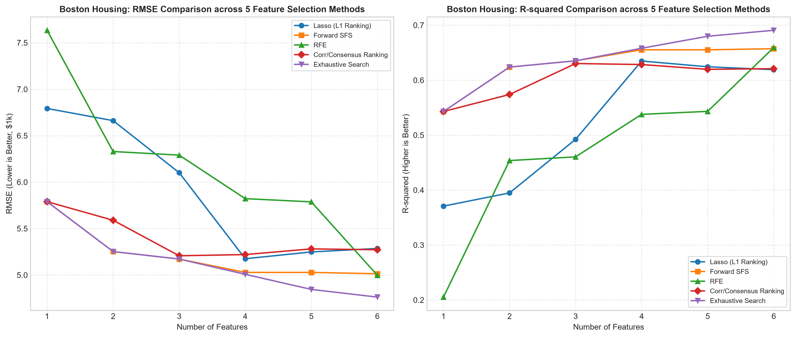

# 📈 AIoT-DA L6: Multiple Linear Regression & Interactive Calculator
## 50 Startups & Boston Housing (CRISP-DM Standard Pipeline)

---

### 🌐 專案核心網址導覽 (Project & Quick Access URLs)

| 類別 (Category) | 項目名稱 (Resource Name) | 完整 URL 連結 (Full URL) |
| :--- | :--- | :--- |
| **🐙 GitHub 專案庫** | **原始碼儲存庫 (Source Code Repository)** | [https://github.com/naz0914/50-Startups-dataset-for-Multiple-Linear-Regression](https://github.com/naz0914/50-Startups-dataset-for-Multiple-Linear-Regression) |
| **🚀 互動式網站 1** | **📈 50 Startups 新創獲利預測計算器 (Live Demo)** | [https://naz0914.github.io/50-Startups-dataset-for-Multiple-Linear-Regression/](https://naz0914.github.io/50-Startups-dataset-for-Multiple-Linear-Regression/) |
| **🚀 互動式網站 2** | **🏡 Boston Housing 波士頓房價估價系統 (Live Demo)** | [https://naz0914.github.io/50-Startups-dataset-for-Multiple-Linear-Regression/boston.html](https://naz0914.github.io/50-Startups-dataset-for-Multiple-Linear-Regression/boston.html) |
| **📊 UI 原型參考** | **StatsUnlock 線上多元線性迴歸計算器** | [https://statsunlock.com/multiple-linear-regression-calculator/](https://statsunlock.com/multiple-linear-regression-calculator/) |
| **📁 原始資料 1** | **Kaggle 50 Startups 資料集說明** | [https://www.kaggle.com/code/akash17/50-startups-linearregression](https://www.kaggle.com/code/akash17/50-startups-linearregression) |
| **📁 原始資料 2** | **50 Startups 原始 CSV 檔案 (Gist Raw)** | [https://gist.githubusercontent.com/GaneshSparkz/.../50_Startups.csv](https://gist.githubusercontent.com/GaneshSparkz/b5662effbdae8746f7f7d8ed70c42b2d/raw/faf8b1a0d58e251f48a647d3881e7a960c3f0925/50_Startups.csv) |
| **📁 原始資料 3** | **50 Startups 備用 CSV (GitHub Raw)** | [https://github.com/harimittapalli/Mulitple-Linear-Reggression/.../50_Startups.csv](https://github.com/harimittapalli/Mulitple-Linear-Reggression/raw/master/50_Startups.csv) |
| **📁 原始資料 4** | **Boston Housing 原始 CSV 檔案 (GitHub Raw)** | [https://raw.githubusercontent.com/selva86/datasets/master/BostonHousing.csv](https://raw.githubusercontent.com/selva86/datasets/master/BostonHousing.csv) |
| **📁 原始資料 5** | **CMU StatLib Boston Housing 檔案庫** | [http://lib.stat.cmu.edu/datasets/boston](http://lib.stat.cmu.edu/datasets/boston) |
| **📖 課程與學術參考 1** | **iT 邦幫忙 鐵人賽多元迴歸教學範例** | [https://ithelp.ithome.com.tw/m/articles/10299081](https://ithelp.ithome.com.tw/m/articles/10299081) |
| **🎓 課程與學術參考 2** | **國立聯合大學 陳士杰教授 機器學習搜尋演算法教學** | [http://debussy.im.nuu.edu.tw/sjchen/ML_final.html](http://debussy.im.nuu.edu.tw/sjchen/ML_final.html) |

---

[](LICENSE)
[](https://github.com/naz0914/50-Startups-dataset-for-Multiple-Linear-Regression)
[](https://naz0914.github.io/50-Startups-dataset-for-Multiple-Linear-Regression/)
[](https://naz0914.github.io/50-Startups-dataset-for-Multiple-Linear-Regression/boston.html)
[](https://www.python.org/downloads/)
[](https://scikit-learn.org/)
[](https://www.chartjs.org/)

An end-to-end Machine Learning suite implementing **Multiple Linear Regression** on both **Kaggle 50 Startups** and **Kaggle Boston Housing** datasets following the **CRISP-DM (Cross-Industry Standard Process for Data Mining)** methodology. Developed in collaboration with **ChatGPT Prompt Engineering**, this repository includes production-grade Python modeling pipelines, comprehensive **5 Feature Selection Algorithms Benchmarks**, interactive **Jupyter Notebooks**, and a modern **StatsUnlock-style web dashboard** equipped with a real-time **Dataset Dropdown Switcher**.

---

## 🌐 Live Demos & Interactive Dashboards

| Project / Dataset | Live URL | Local Path | Description |
| :--- | :--- | :--- | :--- |
| **📈 50 Startups Profit Prediction** | [50 Startups Live Demo](https://naz0914.github.io/50-Startups-dataset-for-Multiple-Linear-Regression/) | `http://localhost:8000/index.html` | Predict startup profitability ($\hat{y}$) from R&D, Marketing, Admin spend, and State. |
| **🏡 Boston Housing Price Valuation** | [Boston Housing Live Demo](https://naz0914.github.io/50-Startups-dataset-for-Multiple-Linear-Regression/boston.html) | `http://localhost:8000/boston.html` | Estimate median home prices (MEDV, $1,000s) from rooms, socioeconomic status, and school ratios. |

> 💡 **Project Switcher Dropdown**: Both web interfaces feature a navigation dropdown menu in the top bar allowing instant switching between the **50 Startups** and **Boston Housing** projects.

---

## 🌟 Interactive Web Highlights (StatsUnlock Aesthetic)

1. **Dual Real-Time What-If Simulators**:
   - **50 Startups**: Sliders for **R&D Spend**, **Marketing Spend**, and **Administration Spend**, plus **State** categorical picker.
   - **Boston Housing**: Sliders for **Rooms (RM)**, **Low-Income % (LSTAT)**, **Pupil-Teacher Ratio (PTRATIO)**, **Distance (DIS)**, **Crime (CRIM)**, **Tax (TAX)**, **Highways (RAD)**, and **Charles River (CHAS)**.
   - Real-time animated calculations of expected values ($\hat{y}$) with **95% Confidence Intervals** and dynamic formula substitutions.
2. **Model Preset Switchers**:
   - 🏆 **Optimal Pruned Models**: Top 2 for 50 Startups ($R^2 = 0.9474$) / Top 4 for Boston Housing ($R^2 = 0.6553$).
   - 📊 **Full All-in Models**: All predictors included with full OLS regression coefficients.
3. **5-Method Dual Diagnostic Visualizer (Chart.js)**:
   - Interactive dual-metric switcher for **RMSE** and **$R^2$** trajectories across $k = 1..k_{max}$.
   - Actual vs. Predicted scatter plots with the ideal $y = x$ reference line.
   - 5-Fold cross-validation learning curves diagnosing overfit vs. underfit conditions.
   - Relative feature importance bar charts.
4. **OLS Regression & VIF Diagnostics Tables**:
   - Unstandardized coefficients ($B$), Standard Errors, $t$-statistics, $p$-values, 95% CI, and **VIF (Variance Inflation Factor)**.
5. **Raw Dataset Explorers & APA Report Generators**:
   - Live search and filter across dataset records.
   - One-click copy for **APA 7th Edition** academic write-ups and business decision insights.
   - CSV export functionality.

---

## 🔬 5 Feature Selection Methods Benchmarks

We evaluated feature selection performance across **Filter**, **Wrapper**, and **Embedded** paradigms (**Lasso L1**, **Forward SFS**, **Recursive Feature Elimination (RFE)**, **Correlation / Consensus Ranking**, and **Exhaustive Subset Search**).

### 1. 50 Startups Feature Selection Benchmark


| Number of Features ($k$) | Selected Features Subset | RMSE ($) | $R^2$ Score | Selection Verdict |
| :---: | :--- | :---: | :---: | :--- |
| **1** | `['R&D Spend']` | `$8,274.87` | `0.946459` | Dominant single linear predictor |
| **2** | `['R&D Spend', 'Marketing Spend']` | **`$8,198.80`** | **`0.947439`** | 🏆 **Global Optimum (Lowest RMSE, Highest $R^2$)** |
| **3** | `['R&D Spend', 'Marketing Spend', 'State_New York']` | `$8,309.06` | `0.946015` | Adding location introduces slight noise |
| **4** | `['R&D Spend', 'Marketing Spend', 'State_NY', 'State_FL']` | `$8,409.92` | `0.944697` | Model complexity increases error variance |
| **5 (All-in)** | `[..., 'Administration']` | `$9,137.99` | `0.934707` | Administration lacks significance ($p = 0.624$) |

---

### 2. Boston Housing Feature Selection Benchmark


| Number of Features ($k$) | Selected Features Subset | RMSE ($1k) | $R^2$ Score | Selection Verdict |
| :---: | :--- | :---: | :---: | :--- |
| **1** | `['LSTAT']` | `$5.790k` | `0.542918` | Primary socioeconomic predictor |
| **2** | `['LSTAT', 'PTRATIO']` | `$5.252k` | `0.623795` | School district quality adds significant power |
| **3** | `['LSTAT', 'PTRATIO', 'RAD']` | `$5.172k` | `0.635229` | Highway accessibility contribution |
| **4** | `['LSTAT', 'PTRATIO', 'RAD', 'TAX']` | **`$5.028k`** | **`0.655255`** | 🏆 **Optimal Parsimony (Lowest Error/Complexity Ratio)** |
| **5** | `['LSTAT', 'PTRATIO', 'RAD', 'TAX', 'CHAS']` | `$5.028k` | `0.655260` | Waterfront view premium added |
| **6** | `[..., 'NOX']` | `$5.014k` | `0.657202` | Marginal gain diminishes |
| **13 (All-in)** | All 13 Features | `$4.929k` | `0.668759` | Baseline full model |

---

## 🔄 CRISP-DM Methodology Walkthrough

```
                      ┌── 1. Business Understanding (VC Profitability & Property Valuation)
                      ├── 2. Data Understanding (Bivariate Scatter Plots & Summary Statistics)
CRISP-DM Cycle ────── ┼── 3. Data Preparation (One-Hot Encoding, Dummy Trap, 80/20 Train/Test Split)
                      ├── 4. Modeling (Multiple Linear Regression & 5 OLS Assumptions)
                      ├── 5. Evaluation (R², RMSE, MAE, Learning Curves & Feature Selection)
                      └── 6. Deployment (pickle, gzip Serialization & Web Inference Engine)
```

1. **Business Understanding**: Predict startup profitability for VC capital allocation and estimate Boston metropolitan housing prices for real estate assessment.
2. **Data Understanding**: Clean datasets with 0 missing values; inspected correlation matrices and bivariate distributions.
3. **Data Preparation**: Handled categorical dummy variables with `drop_first=True` to eliminate multicollinearity; split 80% train / 20% test.
4. **Modeling**: Trained Ordinary Least Squares (OLS) models verifying linearity, homoscedasticity, normality, independence, and VIF $< 5$.
5. **Evaluation**: Benchmark 5 feature selection techniques and learning curves to verify absence of overfitting.
6. **Deployment**: Exported models to `.pkl` and `.pkl.gz` formats with interactive zero-install web applications.

---

## 📁 Repository Structure

```bash
Multiple-Linear-Regression/
├── index.html                                          # 50 Startups StatsUnlock web application
├── boston.html                                         # Boston Housing StatsUnlock web application
├── style.css                                           # Unified responsive CSS design system
├── app.js                                              # 50 Startups client-side engine & Chart.js logic
├── boston.js                                           # Boston Housing client-side engine & Chart.js logic
├── app_data.json                                       # Precomputed OLS metrics & 50 startups records
├── boston_data.json                                    # Precomputed OLS metrics & Boston housing records
├── 50_Startup_Multiple_Linear_Regression.ipynb           # 50 Startups Jupyter Notebook
├── Boston_Housing_Multiple_Linear_Regression.ipynb     # Boston Housing Jupyter Notebook
├── multiple_linear_regression.py                       # 50 Startups end-to-end Python pipeline
├── boston_housing.py                                   # Boston Housing end-to-end Python pipeline
├── feature_selection.py                                # 5-Method feature selection benchmark
├── model.pkl / model.pkl.gz                            # 50 Startups serialized models
├── boston_model.pkl / boston_model.pkl.gz              # Boston Housing serialized models
├── feature_selection_comparison_5methods.png           # 50 Startups 5-method comparison plot
├── boston_feature_selection_comparison.png             # Boston Housing 5-method comparison plot
├── actual_vs_predicted.png                             # 50 Startups actual vs predicted plot
├── boston_actual_vs_predicted.png                      # Boston Housing actual vs predicted plot
├── requirements.txt                                    # Python dependencies
└── README.md                                           # Comprehensive documentation
```

---

## 🚀 Quick Start Guide

### 1. Clone the Repository
```bash
git clone https://github.com/naz0914/50-Startups-dataset-for-Multiple-Linear-Regression.git
cd 50-Startups-dataset-for-Multiple-Linear-Regression
```

### 2. Install Python Dependencies
```bash
pip install -r requirements.txt
```

### 3. Run Pipelines
```bash
# 50 Startups Pipeline
python multiple_linear_regression.py

# Boston Housing Pipeline
python boston_housing.py
```

### 4. Launch Web Applications Locally
```bash
python -m http.server 8000
# Open 50 Startups:     http://localhost:8000/index.html
# Open Boston Housing:  http://localhost:8000/boston.html
```

---

## 🙏 Acknowledgments & References

We gratefully acknowledge the following data sources, educational courses, and analytical tools referenced in the development of this project:

1. **Web Design & Statistical Tool Reference**:
   - [StatsUnlock – Multiple Linear Regression Calculator](https://statsunlock.com/multiple-linear-regression-calculator/): Inspiration for the card layout, OLS coefficient tables, VIF multicollinearity reporting, and APA-formatted summary structure.
2. **Dataset Providers**:
   - [Kaggle: 50 Startups Data for Multiple Linear Regression](https://www.kaggle.com/code/akash17/50-startups-linearregression)
   - [GaneshSparkz 50_Startups Raw CSV Gist](https://gist.githubusercontent.com/GaneshSparkz/b5662effbdae8746f7f7d8ed70c42b2d/raw/faf8b1a0d58e251f48a647d3881e7a960c3f0925/50_Startups.csv)
   - [Hari Mittapalli 50_Startups.csv GitHub Repository](https://github.com/harimittapalli/Mulitple-Linear-Reggression/raw/master/50_Startups.csv)
   - [Selva Prabhakaran Boston Housing Dataset Repository](https://raw.githubusercontent.com/selva86/datasets/master/BostonHousing.csv)
   - [CMU StatLib Boston Housing Dataset Archive](http://lib.stat.cmu.edu/datasets/boston)
3. **Course Curriculum & Framework**:
   - **AIoT-DA L6: Multiple Linear Regression with ChatGPT (2026)**: Curriculum guidance on CRISP-DM standard workflows, prompt engineering, dummy variable trap prevention, and model diagnostic curves.
   - [iT 邦幫忙 鐵人賽多元迴歸教學範例](https://ithelp.ithome.com.tw/m/articles/10299081)
   - [國立聯合大學 陳士杰教授 機器學習搜尋演算法 (Meta-heuristics) 教學](http://debussy.im.nuu.edu.tw/sjchen/ML_final.html)
4. **Core Libraries**:
   - [Scikit-learn](https://scikit-learn.org/) (LinearRegression, LassoCV, RFE, train_test_split, learning_curve)
   - [Chart.js](https://www.chartjs.org/) (Interactive responsive charting)
   - [Pandas](https://pandas.pydata.org/) & [NumPy](https://numpy.org/) & [Matplotlib](https://matplotlib.org/) & [Seaborn](https://seaborn.pydata.org/)

---

## 📄 License
This project is open-source under the [MIT License](LICENSE).
