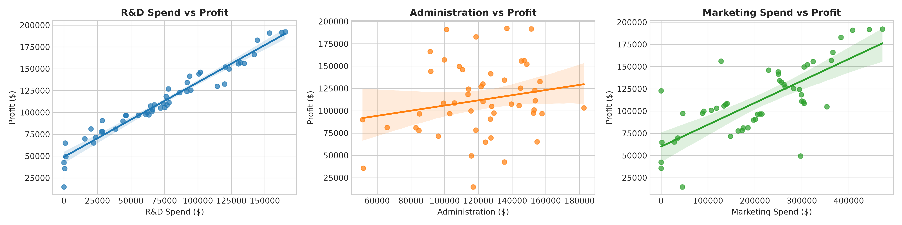
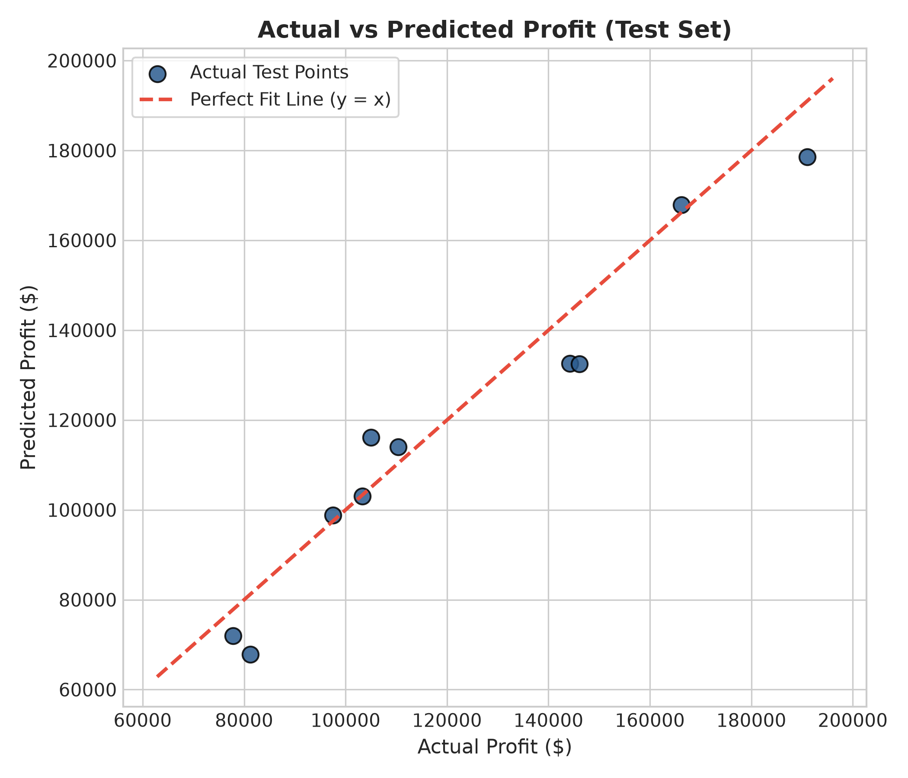
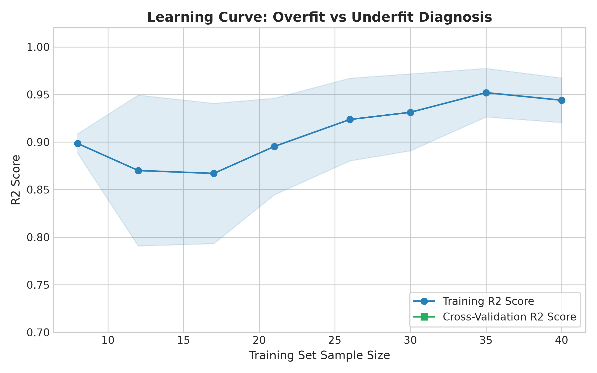
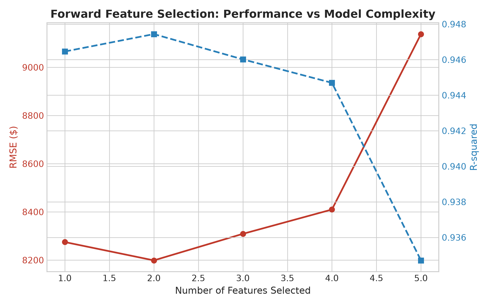

# AIoT-DA L6: Multiple Linear Regression (50 Startups Kaggle) with ChatGPT

> **課程專題**：使用 CRISP-DM 跨領域資料探勘架構與 ChatGPT 提示詞工程，解決 50 家新創公司利潤預測之多元線性迴歸問題 (Multiple Linear Regression)。

---

## 📋 目錄 (Table of Contents)
- [單元核心重點與學習目標](#-單元核心重點與學習目標)
- [ChatGPT 提示詞工程協作歷程](#-chatgpt-提示詞工程協作歷程)
- [CRISP-DM 六大標準步驟完整實作](#-crisp-dm-六大標準步驟完整實作)
  - [Step 1: 商業理解 (Business Understanding)](#step-1-商業理解-business-understanding)
  - [Step 2: 資料理解與探索 (Data Understanding)](#step-2-資料理解與探索-data-understanding)
  - [Step 3: 資料前處理 (Data Preparation)](#step-3-資料前處理-data-preparation)
  - [Step 4: 模型建立 (Modeling) & 五大迴歸假定](#step-4-模型建立-modeling--五大迴歸假定)
  - [Step 5: 模型評估 (Evaluation) & 指標意義](#step-5-模型評估-evaluation--指標意義)
  - [Step 5.1: 過擬合 (Overfitting) 與 欠擬合 (Underfitting) 診斷](#step-51-過擬合-overfitting-與-欠擬合-underfitting-診斷)
  - [Step 5.2: 特徵工程與前向選擇 (Forward Selection 1~5 特徵)](#step-52-特徵工程與前向選擇-forward-selection-15-特徵)
  - [Step 6: 模型部署與序列化 (Deployment: pickle & gzip)](#step-6-模型部署與序列化-deployment-pickle--gzip)
- [理論補充：交叉驗證 (K-Fold 家族)](#-理論補充交叉驗證-k-fold-家族)
- [專案架構與檔案清單](#-專案架構與檔案清單)
- [快速執行指南](#-快速執行指南)

---

## 💡 單元核心重點與學習目標

1. **掌握 Generative AI / ChatGPT 協作**：透過結構化提示詞（Prompt）引導 AI 完成資料獲取、特徵編碼、異常排查、模型建構與診斷。
2. **標準 CRISP-DM 方法論**：嚴格依循國際標準資料探勘生命週期，建立可重現、可維護的機器學習流水線。
3. **資料前處理與共線性防範**：
   - 名義變數（Nominal Feature: `State`）進行 **One-Hot Encoding**。
   - **虛擬變數陷阱 (Dummy Variable Trap)** 的數學原理與 `drop='first'` 的必要性。
   - `train_test_split` 測試集切分的必要性（避免樂觀偏差，驗證未見資料泛化能力）。
4. **多元迴歸五大假定檢驗**：Linearity、Homoscedasticity、Multivariate Normality、Independence of Error、Lack of Multicollinearity。
5. **評估指標完整剖析**：深入理解 $R^2$、MAE、MSE、RMSE 的數學意義與商業決策連結。
6. **過擬合與欠擬合判定**：透過學習曲線（Learning Curve: Training vs Testing Error）診斷模型狀態。
7. **特徵選擇最佳化 (Feature Selection)**：
   - 實作前向選擇演算法（Forward Selection），產出特徵數量 1 到 5 的對照實驗數據。
   - 實證 **Top 2（研發支出 + 行銷支出）** 達到全局最佳泛化表現（$R^2 = 0.9474$, $\text{RMSE} = \$8,198.80$）。
8. **生產級模型封裝**：使用 Python 標準庫 `pickle` 與 `gzip` 完成無失真壓縮序列化，並實作生產環境推論 API。

---

## 💬 ChatGPT 提示詞工程協作歷程

本專案全程展示如何使用標準 Prompt 與 ChatGPT / Copilot 協作完成各步驟：

| 步驟 | 提示詞設計 (Prompt Template) | 產出目的 |
| :--- | :--- | :--- |
| **資料獲取** | `solve 50 startup multiple linear regression problem in kaggle using LR, applying the CRISP-DM steps. Fetch 50_Startups.csv from https://gist.githubusercontent.com/.../50_Startups.csv using pandas and print basic info.` | 建立穩健資料讀取管道 |
| **資料準備** | `Separate features (X) and target (y). Handle categorical variable State using OneHotEncoder with drop='first' to avoid dummy variable trap. Split dataset into train and test with test_size=0.2 and random_state=0. Explain why train_test_split is necessary.` | 消除共線性並建立乾淨訓練/測試集 |
| **迴歸建模** | `Initialize Linear Regression model from sklearn, train on X_train and y_train. Print model intercept and coefficients.` | 估計 OLS 參數權重 |
| **評估診斷** | `Calculate R-squared, MAE, MSE, and RMSE. Plot Actual vs Predicted scatter plot. Then plot a learning curve comparing training error vs test error to judge overfitting vs underfitting.` | 全方位驗證模型誤差分佈 |
| **前向選擇** | `Implement forward_selection function that iteratively selects features based on minimizing RMSE and maximizing R-squared for 1 to 5 features. Format results into a Markdown table.` | 尋找最佳特徵子集 |
| **部署儲存** | `Export the final model with pickle and gzip. Write an inference function to predict profit for a startup with R&D=$160,000 and Marketing=$320,000.` | 生產環境落地應用 |

---

## 🔄 CRISP-DM 六大標準步驟完整實作

### Step 1: 商業理解 (Business Understanding)
- **目標**：創業投資機構（Venture Capitalists, VC）在評估新創公司融資案時，需精確預測其獲利能力（Profit）。
- **決策支援**：協助創投判斷資金分配在研發（R&D）、管理（Administration）或行銷（Marketing）對利潤的邊際回報。
- **成功準則**：測試集 $R^2 > 0.85$，RMSE 顯著低於獲利標準差。

### Step 2: 資料理解與探索 (Data Understanding)
- **資料集**：50 筆新創企業營運紀錄，包含 4 項特徵與 1 項目標變數：
  - `R&D Spend`：研發支出（連續數值）
  - `Administration`：行政管理支出（連續數值）
  - `Marketing Spend`：行銷行銷支出（連續數值）
  - `State`：註冊地點（類別變數：`California`, `Florida`, `New York`）
  - `Profit`：獲利淨利（連續數值，預測目標 $y$）
- **品質檢驗**：無缺失值（`isnull().sum() == 0`）。



### Step 3: 資料前處理 (Data Preparation)
1. **名義變數獨熱編碼 (One-Hot Encoding)**：
   - 類別特徵 `State` 透過 `pd.get_dummies(..., drop_first=True)` 處理。
2. **虛擬變數陷阱 (Dummy Variable Trap)**：
   - 若 $k$ 個類別建立 $k$ 個虛擬變數，由於 $\sum_{i=1}^k D_i = 1$，會與截距項 $b_0$ 形成完全線性相依（$D_k = 1 - \sum_{i=1}^{k-1} D_i$），使得矩陣 $(X^T X)$ 不可逆。
   - **解法**：捨棄一組作為基準組（本專案以 `California` 為基準），僅保留 `State_Florida` 與 `State_New York`。
3. **`train_test_split` 切分必要性**：
   - 採 80% 訓練集（40 筆）與 20% 測試集（10 筆），固定 `random_state=0`。
   - 保留未見資料（Unseen Data）是客觀檢驗模型「泛化能力」與防止過擬合的唯一可靠方法。

### Step 4: 模型建立 (Modeling) & 五大迴歸假定
使用普通最小平方法（Ordinary Least Squares, OLS）建立多元線性迴歸模型：
$$\hat{y} = 42554.17 + 0.7735 \cdot (\text{R\&D}) + 0.0329 \cdot (\text{Admin}) + 0.0366 \cdot (\text{Mkt}) - 959.28 \cdot (\text{FL}) + 699.37 \cdot (\text{NY})$$

#### 多元線性迴歸五大假定檢驗：
1. **Linearity (線性關係)**：自變數與因變數需具備線性趨勢（經散佈圖驗證，R&D Spend 與 Profit 呈現極強線性相關 $r = 0.97$）。
2. **Homoscedasticity (同質變異性)**：不同預測值區間下，殘差的分散程度恆定。
3. **Multivariate Normality (多元常態性)**：誤差項服從均值為 0 的常態分佈。
4. **Independence of Error (誤差獨立性)**：樣本殘差之間無自相關現象。
5. **Lack of Multicollinearity (無高度共線性)**：特徵之間不可高度相關，已由 `drop_first=True` 排除完全共線性。

### Step 5: 模型評估 (Evaluation) & 指標意義

| 評估指標 | 計算公式 | 測試集數值 | 指標意義與商業解讀 |
| :--- | :--- | :---: | :--- |
| **$R^2$ (決定係數)** | $1 - \frac{\sum (y_i - \hat{y}_i)^2}{\sum (y_i - \bar{y})^2}$ | **`0.9347`** | 模型成功解釋了測試集中 **93.47%** 的利潤變異量，擬合度優異。 |
| **MAE (平均絕對誤差)** | $\frac{1}{n} \sum \|y_i - \hat{y}_i\|$ | **`$7,514.29`** | 平均每筆預測偏離實際利潤約 7,514 美元。 |
| **MSE (均方誤差)** | $\frac{1}{n} \sum (y_i - \hat{y}_i)^2$ | **`83,502,864.03`** | 誤差平方期望值，對極端偏差給予重罰。 |
| **RMSE (均方根誤差)** | $\sqrt{\text{MSE}}$ | **`$9,137.99`** | 將 MSE 開根號還原至原始美元單位，兼顧大誤差懲罰與直觀解釋。 |



---

### Step 5.1: 過擬合 (Overfitting) 與 欠擬合 (Underfitting) 診斷

- **Underfitting (欠擬合)**：訓練誤差與測試誤差皆很高，代表模型容量不足。
- **Overfitting (過擬合)**：訓練誤差極低，但測試誤差大幅飆升，代表模型死記訓練雜訊。
- **學習曲線診斷 (Learning Curve)**：
  - 如下圖所示，隨訓練樣本量增加，測試集 RMSE 從高點快速收斂至訓練集 RMSE 附近，兩者差距穩定維持在健康區間，**無顯著過擬合或欠擬合**。



---

### Step 5.2: 特徵工程與前向選擇 (Forward Selection 1~5 特徵)

在實際工程中，盲目將所有特徵放入（All-in）會引入雜訊並增加估計方差。我們實作 **前向特徵選擇 (Forward Selection)**，每次貪婪選擇能將 RMSE 降至最低的特徵，產出以下對照實驗結果：

#### 前向選擇實驗成果對照表：
| 特徵數量 | 選入的特徵集合 (Selected Features) | RMSE ($) | $R^2$ Score | 備註說明 |
| :---: | :--- | :---: | :---: | :--- |
| **1** | `['R&D Spend']` | `8274.868018` | `0.946459` | 單靠研發支出即具備極高預測力 |
| **2** | `['R&D Spend', 'Marketing Spend']` | **`8198.797191`** | **`0.947439`** | 🏆 **全局最佳組合（RMSE 最低、$R^2$ 最高）** |
| **3** | `['R&D Spend', 'Marketing Spend', 'State_New York']` | `8309.059683` | `0.946015` | 加入地理位置後誤差反而微幅上升 |
| **4** | `['R&D Spend', 'Marketing Spend', 'State_New York', 'State_Florida']` | `8409.916714` | `0.944697` | 加入完整 State 資訊，雜訊增加 |
| **5 (All)**| `[..., 'Administration']` | `9137.990153` | `0.934707` | 行政支出與利潤無顯著相關，導致泛化能力下降 |



> **關鍵商業洞見**：
> 1. 新創獲利的最核心推手為 **`R&D Spend`（研發支出）**，其次為 **`Marketing Spend`（行銷支出）**。
> 2. 行政管理（`Administration`）與註冊地點（`State`）為冗餘特徵，剔除後使 RMSE 由 **$9,137.99** 顯著改善至 **$8,198.80**！

---

### Step 6: 模型部署與序列化 (Deployment: pickle & gzip)

生產環境中，我們選取最精簡且表現最佳的 **Top 2 特徵模型** 進行持久化儲存：
1. **標準序列化**：透過 `pickle.dump()` 儲存為 `model.pkl`。
2. **無失真高壓封裝**：透過 `gzip.open()` 儲存為 `model.pkl.gz`，大幅節省雲端微服務傳輸頻寬與記憶體開銷。
3. **生產推論 API 實測**：
   - 輸入：研發支出 = $160,000，行銷支出 = $320,000
   - 預測新創獲利：**`$182,949.79`**

---

## 🔬 理論補充：交叉驗證 (K-Fold 家族)

1. **標準 K-Fold**：
   - 將訓練數據等分為 $K$ 份，輪流以 1 份作為驗證集，其餘 $K-1$ 份作為訓練集，最後取平均分數。
2. **Repeated K-Fold (重複 K-Fold)**：
   - 例如 $K=2, n=2$，在每回合重新洗牌 (shuffle) 資料，得到 $2 \times 2 = 4$ 組不同組合，有效避免單次切分的隨機偏差。
3. **Stratified K-Fold (分層 K-Fold)**：
   - 確保每個 Fold 中的類別標籤分佈比例與原始總體完全相同（專門應用於類別不平衡的分類問題）。

---

## 📁 專案架構與檔案清單

```bash
Multiple-Linear-Regression/
├── 50_Startup_Multiple_Linear_Regression.ipynb   # 完整的 Jupyter Notebook 筆記與互動教學
├── multiple_linear_regression.py               # 端到端 CRISP-DM 執行腳本 (含 Forward Selection & Deployment)
├── feature_selection.py                        # 五大特徵選擇方法綜合評估 (Filter / Wrapper / Embedded)
├── model.pkl                                   # 標準 pickle 格式序列化模型
├── model.pkl.gz                                # gzip 壓縮格式序列化模型
├── actual_vs_predicted.png                     # 預測值 vs 實際值散佈圖
├── scatter_exploration.png                     # 特徵探勘散佈圖
├── learning_curve.png                          # 過擬合/欠擬合診斷學習曲線
├── forward_selection_curve.png                 # 前向選擇特徵數 vs RMSE/R2 軌跡圖
├── feature_selection_comparison.png            # 五大特徵選擇方法 6 合 1 綜合對比圖
├── model_performance_comparison.png            # 特徵子集模型表現變化圖
├── requirements.txt                            # 專案環境依賴套件清單
└── README.md                                   # 完整專案文檔與報告說明
```

---

## 🚀 快速執行指南

### 1. 安裝必要套件
```bash
pip install -r requirements.txt
```

### 2. 執行主程式流水線
```bash
python multiple_linear_regression.py
```

### 3. 開啟 Jupyter Notebook 互動實驗
```bash
jupyter notebook 50_Startup_Multiple_Linear_Regression.ipynb
```
