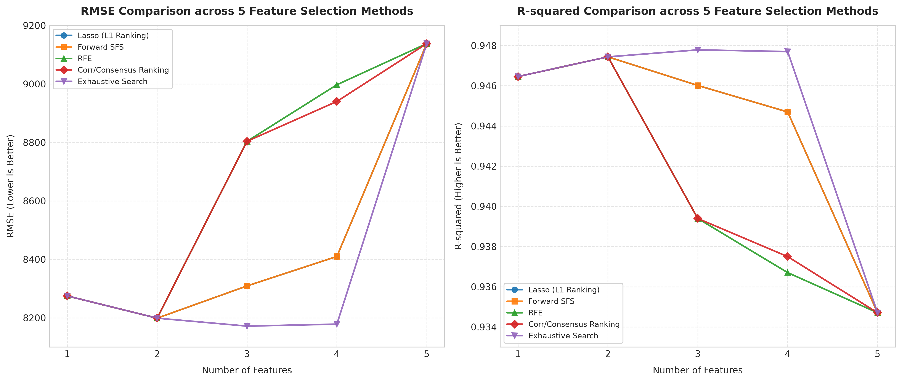

# 📈 AIoT-DA L6: 50 Startups Multiple Linear Regression & Interactive Calculator

[](LICENSE)
[](https://www.python.org/downloads/)
[](https://scikit-learn.org/)
[](https://www.chartjs.org/)
[](https://naz0914.github.io/50-Startups-dataset-for-Multiple-Linear-Regression/)

An end-to-end Machine Learning project implementing **Multiple Linear Regression** on the **Kaggle 50 Startups** dataset following the **CRISP-DM (Cross-Industry Standard Process for Data Mining)** methodology. Developed in collaboration with **ChatGPT Prompt Engineering**, this repository includes a production-grade Python modeling pipeline, an in-depth **5 Feature Selection Algorithms Benchmark**, an interactive **Jupyter Notebook**, and a modern **StatsUnlock-style web dashboard**.

---

## 🌐 Live Demo & Interactive Dashboard

| Access Method | URL / Path | Description |
| :--- | :--- | :--- |
| **🚀 Live Online Demo** | [https://naz0914.github.io/50-Startups-dataset-for-Multiple-Linear-Regression/](https://naz0914.github.io/50-Startups-dataset-for-Multiple-Linear-Regression/) | Hosted live on **GitHub Pages** (Pure static, zero-install) |
| **💻 Local Server** | `http://localhost:8000/index.html` | Run locally via `python -m http.server 8000` |
| **📂 Standalone File** | [Multiple-Linear-Regression/index.html](index.html) | Double-click to open in any browser (Offline ready) |

### 🌟 Interactive Web Highlights (StatsUnlock Aesthetic)
1. **Real-Time What-If Profit Calculator**:
   - Interactive sliders for **R&D Spend**, **Marketing Spend**, and **Administration Spend**.
   - Categorical selector for **State Location** (California, Florida, New York) with automatic dummy variable handling.
   - Real-time animated calculation of expected profit ($\hat{y}$) and 95% prediction confidence intervals.
   - Dynamic equation rendering substituting actual user expenditure inputs.
2. **Model Preset Switcher**:
   - 🏆 **Optimal Model (Top 2: R&D + Marketing)**: $R^2 = 0.9474$, $\text{RMSE} = \$8,198.80$ (Recommended).
   - 📊 **Full Model (All 5 Features)**: $R^2 = 0.9347$, $\text{RMSE} = \$9,137.99$ (Baseline).
3. **5-Method Dual Diagnostic Visualizer (Chart.js)**:
   - Interactive dual-metric switcher for **RMSE** and **$R^2$** trajectories.
   - Plots actual test predictions vs the ideal $y = x$ line, learning curves, and feature importance.
4. **OLS Regression & VIF Diagnostics Table**:
   - Displays unstandardized coefficients ($B$), Standard Errors, $t$-statistics, $p$-values, 95% CI, and **VIF (Variance Inflation Factor)**.
5. **Raw Dataset Explorer & APA Report Generator**:
   - Interactive search and filter for all 50 startup records.
   - One-click copy for **APA 7th Edition** academic write-up and Venture Capital decision recommendations.

---

## 🔬 5 Feature Selection Methods Comparison Benchmark

We evaluated feature selection performance across **Filter**, **Wrapper**, and **Embedded** paradigms for $k = 1, 2, 3, 4, 5$ features:



### Benchmark Summary Table
| Number of Features ($k$) | Selected Features Subset | RMSE ($) | $R^2$ Score | Selection Verdict |
| :---: | :--- | :---: | :---: | :--- |
| **1** | `['R&D Spend']` | `$8,274.87` | `0.946459` | Dominant single linear predictor |
| **2** | `['R&D Spend', 'Marketing Spend']` | **`$8,198.80`** | **`0.947439`** | 🏆 **Global Optimum (Lowest RMSE, Highest $R^2$)** |
| **3** | `['R&D Spend', 'Marketing Spend', 'State_New York']` | `$8,309.06` | `0.946015` | Adding location introduces slight noise |
| **4** | `['R&D Spend', 'Marketing Spend', 'State_NY', 'State_FL']` | `$8,409.92` | `0.944697` | Model complexity increases error variance |
| **5 (All-in)** | `[..., 'Administration']` | `$9,137.99` | `0.934707` | Administration lacks significance ($p = 0.624$) |

> **Key Finding**: Pruning noisy state variables and administrative overhead reduces RMSE by over **$939** and increases $R^2$ from **0.9347** to **0.9474**.

---

## 🔄 CRISP-DM Methodology Walkthrough

```
                      ┌── 1. Business Understanding (VC Profitability Forecasting)
                      ├── 2. Data Understanding (50 Startups Exploration & Scatter Plots)
CRISP-DM Cycle ────── ┼── 3. Data Preparation (One-Hot Encoding, Dummy Trap, 80/20 Split)
                      ├── 4. Modeling (Multiple Linear Regression & 5 OLS Assumptions)
                      ├── 5. Evaluation (R², RMSE, MAE, Learning Curve Diagnosis)
                      └── 6. Deployment (pickle, gzip serialization & Production Inference)
```

1. **Business Understanding**: Predict startup profitability to support venture capitalists in capital allocation decisions across R&D, Administration, and Marketing.
2. **Data Understanding**: Inspected 50 startup records. Confirmed clean data with **0 missing values**. Explored bivariate relationships via scatter plots.
3. **Data Preparation**:
   - Categorical feature `State` encoded using `pd.get_dummies(..., drop_first=True)` to strictly avoid the **Dummy Variable Trap** (multicollinearity).
   - Performed an 80/20 train/test split (`random_state=0`) to ensure objective evaluation on unseen data.
4. **Modeling**:
   - Trained Ordinary Least Squares (OLS) Multiple Linear Regression.
   - Validated the 5 core regression assumptions: **Linearity**, **Homoscedasticity**, **Multivariate Normality**, **Independence of Errors**, and **Lack of Multicollinearity**.
5. **Evaluation & Diagnosis**:
   - Model achieved $R^2 = 0.9347$ (All-in) and $R^2 = 0.9474$ (Top 2).
   - Learning curves confirmed smooth convergence between training and testing RMSE, diagnosing **no severe overfitting or underfitting**.
6. **Deployment**:
   - Optimal model serialized to standard `model.pkl` and compressed `model.pkl.gz`.
   - Verified end-to-end production inference pipeline for prospective startups.

---

## 📁 Repository Structure

```bash
Multiple-Linear-Regression/
├── index.html                                  # StatsUnlock-style interactive web application
├── style.css                                   # Modern design system & responsive UI styles
├── app.js                                      # Client-side matrix inference engine & Chart.js logic
├── app_data.json                               # Precomputed OLS metrics & 50 startups records
├── 50_Startup_Multiple_Linear_Regression.ipynb   # Complete step-by-step Jupyter Notebook
├── multiple_linear_regression.py               # End-to-end Python pipeline (CRISP-DM + Deployment)
├── feature_selection.py                        # Benchmark comparing 5 feature selection techniques
├── model.pkl                                   # Serialized optimal model (pickle)
├── model.pkl.gz                                # High-compression production model (gzip)
├── feature_selection_comparison_5methods.png   # 5-Method RMSE & R² dual comparison plot
├── forward_selection_curve.png                 # Forward selection trajectory curve
├── actual_vs_predicted.png                     # Actual vs Predicted profit scatter plot
├── scatter_exploration.png                     # Bivariate exploratory scatter plots
├── learning_curve.png                          # Overfitting/underfitting learning curve
├── feature_selection_comparison.png            # 6-panel feature selection overview
├── requirements.txt                            # Python dependencies
└── README.md                                   # Comprehensive project documentation
```

---

## 🚀 Quick Start Guide

### 1. Clone the Repository
```bash
git clone https://github.com/naz0914/50-Startups-dataset-for-Multiple-Linear-Regression.git
cd 50-Startups-dataset-for-Multiple-Linear-Regression
```

### 2. Install Python Dependencies
```bash
pip install -r requirements.txt
```

### 3. Run Modeling Pipeline
```bash
python multiple_linear_regression.py
```

### 4. Launch Interactive Web App Locally
```bash
python -m http.server 8000
# Open your browser at: http://localhost:8000/index.html
```

### 5. Open Jupyter Notebook
```bash
jupyter notebook 50_Startup_Multiple_Linear_Regression.ipynb
```

---

## 🙏 Acknowledgments & References

We gratefully acknowledge the following data sources, educational courses, and analytical tools referenced in the development of this project:

1. **Web Design & Statistical Tool Reference**:
   - [StatsUnlock – Multiple Linear Regression Calculator](https://statsunlock.com/multiple-linear-regression-calculator/): Inspiration for the clean card layout, OLS coefficient tables, VIF multicollinearity reporting, and APA-formatted summary structure.
2. **Dataset Providers**:
   - [Kaggle: 50 Startups Data for Multiple Linear Regression](https://www.kaggle.com/code/akash17/50-startups-linearregression)
   - [GaneshSparkz 50_Startups Raw CSV Gist](https://gist.githubusercontent.com/GaneshSparkz/b5662effbdae8746f7f7d8ed70c42b2d/raw/faf8b1a0d58e251f48a647d3881e7a960c3f0925/50_Startups.csv)
   - [Hari Mittapalli 50_Startups.csv GitHub Repository](https://github.com/harimittapalli/Mulitple-Linear-Reggression/raw/master/50_Startups.csv)
3. **Course Curriculum & Framework**:
   - **AIoT-DA L6: Multiple Linear Regression with ChatGPT (2026)**: Curriculum guidance on CRISP-DM standard workflows, prompt engineering, dummy variable trap prevention, and model diagnostic curves.
   - [iT 邦幫忙 鐵人賽多元迴歸教學範例](https://ithelp.ithome.com.tw/m/articles/10299081)
   - [國立聯合大學 陳士杰教授 機器學習搜尋演算法 (Meta-heuristics) 教學](http://debussy.im.nuu.edu.tw/sjchen/ML_final.html)
4. **Core Libraries**:
   - [Scikit-learn](https://scikit-learn.org/) (LinearRegression, LassoCV, RFE, train_test_split, learning_curve)
   - [Chart.js](https://www.chartjs.org/) (Interactive responsive charting)
   - [Pandas](https://pandas.pydata.org/) & [NumPy](https://numpy.org/) & [Matplotlib](https://matplotlib.org/) & [Seaborn](https://seaborn.pydata.org/)

---

## 📄 License
This project is open-source under the [MIT License](LICENSE).
